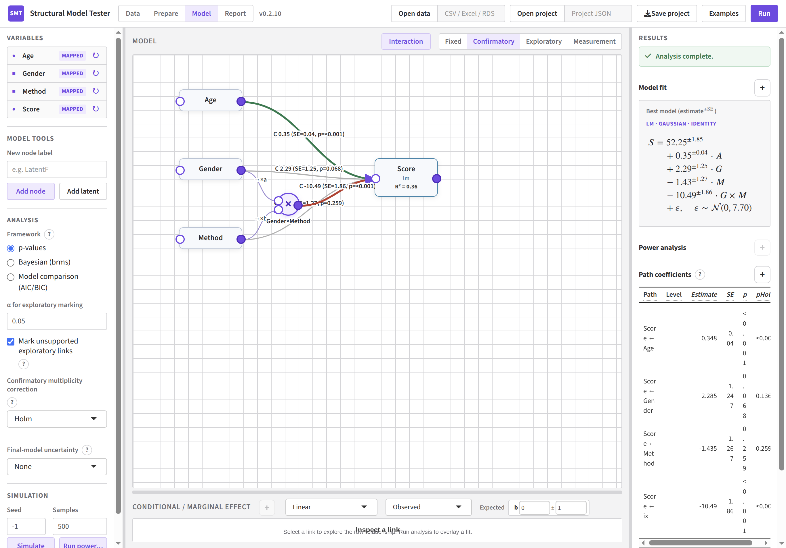
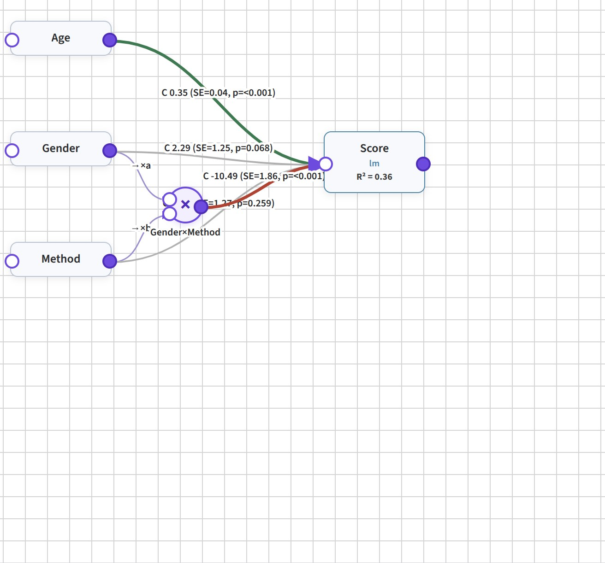
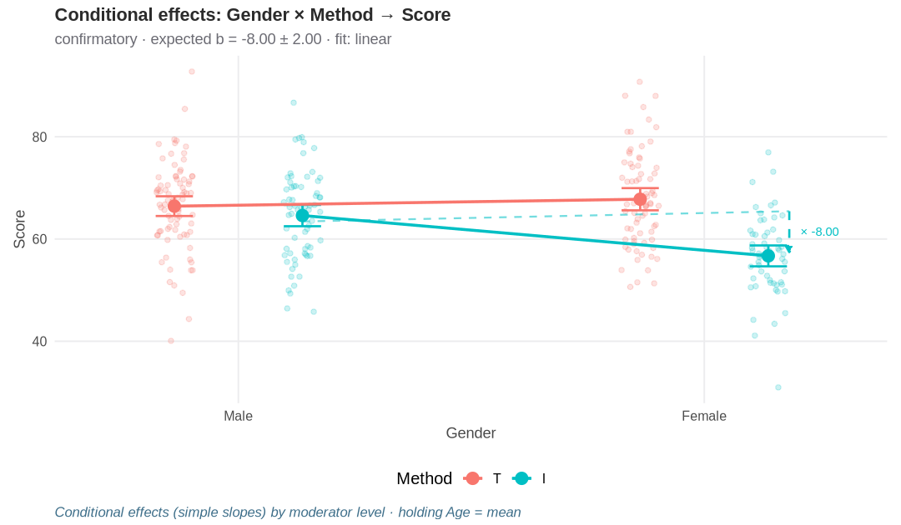
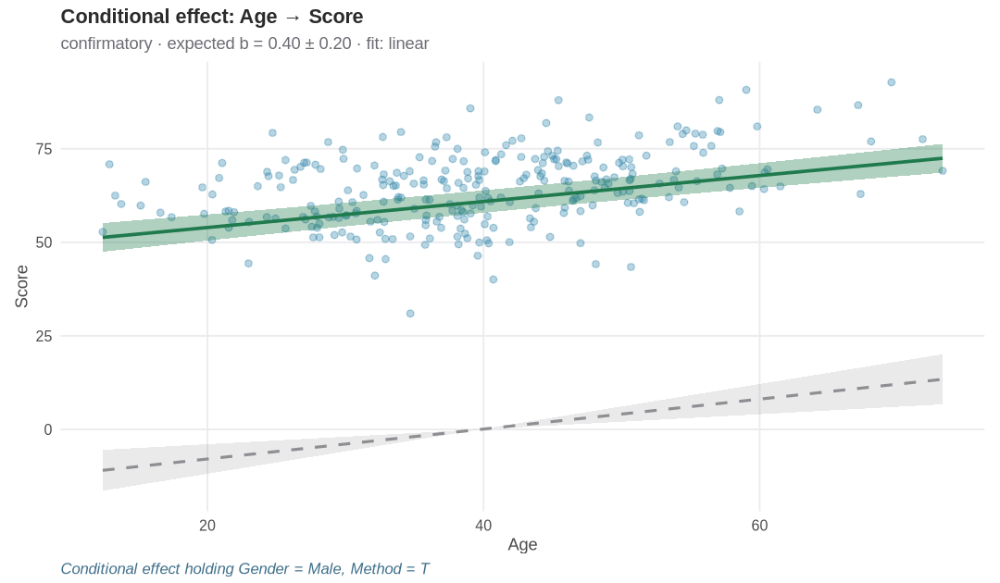
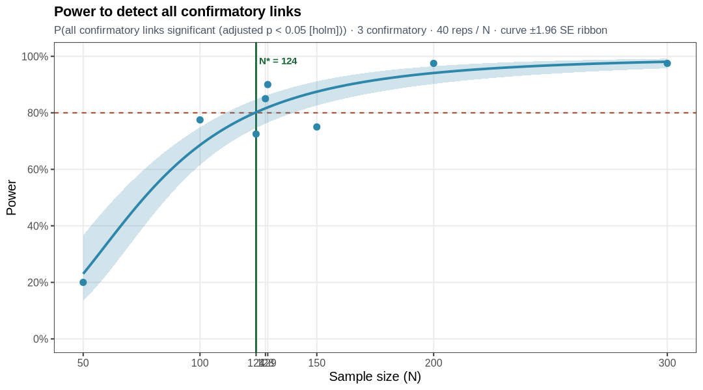
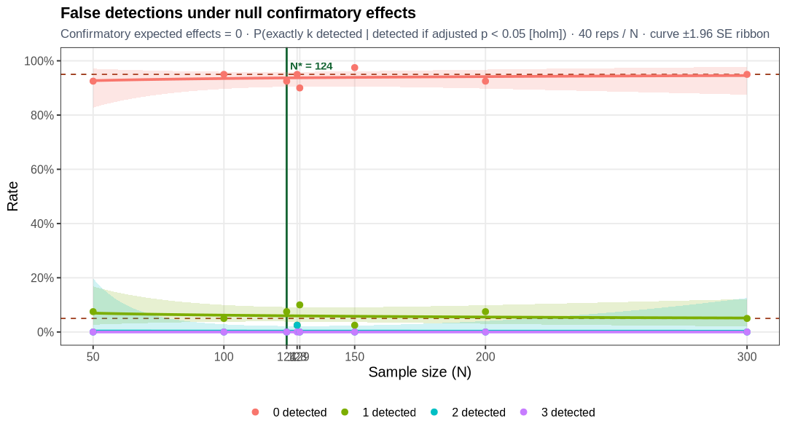

# Structural Model Tester

Visual path / SEM workbench for R: draw the model, set expected effects as priors, simulate or fit real data (classical, information-criteria search, or Bayesian), and plan sample size — in one Shiny app.

<p align="center">
  
</p>

## What it does

- **Canvas model editor** — observed / latent / interaction (×) nodes; drag links that are *fixed*, *confirmatory*, *exploratory*, or *measurement*
- **Three inference frameworks** — classical **p-values** (optional exploratory marking + confirmatory multiplicity correction); **AIC/BIC search** with optional full model averaging and **Σw** link rejection; **Bayesian (brms)** with HDI, pd, ROPE, log BF₁₀, and MCMC / PPC diagnostics
- **Simulation from expected `b`** — unstandardized slopes (also used as normal priors under Bayesian); treatment contrasts for factors; Inter / Intra allocation with probability or exact level counts
- **Conditional / marginal & mediation plots** — inspect a link with prior band and fit overlay; path tables include via / total effects when mediators are present
- **Pedagogical field help** — clickable `?` modals on controls (priors, ROPE, BF₁₀, MCMC, …)
- **Confirmatory power analysis** — Monte Carlo power and null false-detection curves, with a recommended **N\***

Works anywhere R runs (Linux, Windows, macOS). If no system browser is configured, `run_app()` still starts and prints the URL.

## Screenshots

### Path diagram with interactions

<p align="center">
  
</p>

Build confirmatory mains and `Gender × Method` interactions on the canvas; dashed / solid styling reflects search, p-value, or Bayesian decisions after **Run** or **Simulate**.

### Conditional effects

<p align="center">
  
</p>

Selecting a link opens the **Conditional / marginal effect** panel. Interaction plots show simple slopes by moderator level, a dashed *mains-only* ghost line, and a correction arrow in the active group’s colour.

<p align="center">
  
</p>

Continuous links use **Expected `b`** (raw slope), not standardized β — so simulation and Bayesian priors match the units you type.

### Power and false detections

<p align="center">
  
</p>

<p align="center">
  
</p>

**Run Power Analysis** estimates detection power under your expected effects and, with confirmatory effects set to 0, the rate of detecting *k* spurious links. Search mode can require Σw ≥ a threshold (default 0.95) so N\* targets both power and low false retention.

## Install

```r
install.packages(c(
  "shiny", "ggplot2", "lavaan", "readr", "readxl",
  "jsonlite", "DT", "lme4", "lmerTest", "emmeans"
))
# Optional Bayesian backend:
# install.packages(c("brms", "cmdstanr"))  # or rstan
# from GitHub:
remotes::install_github("BapJacquet/StructuralModelTester")
```

From a local clone:

```r
# remotes::install_local(".", force = TRUE)
```

**Requirements:** R ≥ 4.1 and a modern browser.

## Run

```r
library(StructuralModelTester)
run_app()

# Seed the Data tab (skips the examples modal):
# run_app(data = my_data)

# Echo [smt-debug] lines to the console while developing:
# run_app(debug = TRUE)
```

During development from the source tree:

```r
# pkgload::load_all()  # or remotes::install_local(".", force = TRUE)
run_app()
```

Stop the app from the R console with **Esc** (RStudio / Positron) or **Ctrl+C** (terminal). If a browser does not open, paste the printed `http://…` URL manually (or set `options(browser = "firefox")` / the `BROWSER` env var).

## Quick start

1. On launch, a welcome modal offers built-in examples (**Path model**, **Causal chain**, **Interaction**, **Repeated measures**, **Latent measurement**, **Ordered quadratic**) or **Start blank**. Nothing is loaded until you choose. Reopen anytime via **Examples** in the top bar — or **Open data** (CSV / TSV / Excel / RDS). For SoSci Survey exports, set **Skip rows after header** to `1` on the Data tab to drop the description row.
2. In **Variables**, click **＋** to place observed nodes (or **Add node** / **Add latent** / **Interaction**).
3. On **Model**, drag between ports. Choose link role: Fixed / Confirmatory / Exploratory / Measurement. Pick a **Framework** (p-values, AIC/BIC search, or Bayesian).
4. Set **Expected `b`** (and uncertainty) on selected structural links for simulation, power, and Bayesian priors.
5. **Run** on loaded data, or **Simulate** from the generative settings, then inspect the canvas, equations, path-coefficient table, and link plots (plus MCMC/PPC under Bayesian).
6. Optionally **Run Power Analysis** for confirmatory N\*.

**Save project** / **Open project** stores the graph (nodes, links, priors, sim knobs) as JSON. Data files are opened separately.

Built-in example graphs and CSVs live under [`inst/sample_data/`](inst/sample_data/).

## Project file format

Projects are UTF-8 JSON (`version: 1`). They describe the **model graph and simulation knobs only** — not the data table (open CSV/Excel/RDS separately and re-map columns if needed).

Top-level keys:

| Key | Type | Role |
|-----|------|------|
| `version` | integer | Schema version (`1`) |
| `nodes` | array of objects | Variables / latents / × operators |
| `edges` | array of objects | Structural, measurement, and × wiring links |
| `next_node` | integer | Counter for new node ids |
| `next_edge` | integer | Counter for new edge ids |
| `prepare` | object (optional) | Saved data-prepare recipe when present |

### Nodes

Each node is one canvas object. Important fields:

| Field | Notes |
|-------|--------|
| `id`, `label` | Stable id (referenced by edges); display label |
| `node_kind` | `observed`, `latent`, or `interaction` |
| `observed_column` | Mapped data column, or null / omitted if unmapped |
| `shape` | `box`, `ellipse`, or `operator` (×) |
| `x`, `y` | Canvas position |
| `cat_mode` | `split` or `omnibus` (categorical factors) |
| `factor_a`, `factor_b` | For interactions: ids of the two wired factors |
| `factor_base`, `factor_levels`, `factor_ordered` | Reference coding; `factor_levels` is newline-separated |
| `sim_var_kind` | Declared type for unmapped sim: `continuous`, `categorical`, `binary` |
| `sim_mean`, `sim_sd`, `sim_min`, `sim_max` | Exogenous continuous generative settings |
| `sim_intercept`, `sim_resid_sd` | Outcome generative settings (logit intercept when binary) |
| `sim_design_mode` | `inter` / `intra` for factors |
| `sim_alloc_mode` | `probability` / `exact` |
| `sim_level_props`, `sim_level_counts` | Encoded level allocation strings |
| `repeated_measures`, `cluster_column` | Random-intercept DV options |
| `dv_transform` | Outcome transform id (`none`, …) |
| `r_squared`, `r_squared_kind` | Fit diagnostics (often null in a saved project) |

### Edges

| Field | Notes |
|-------|--------|
| `id`, `from`, `to` | Edge id; node ids |
| `type` | `fixed`, `confirmatory`, `exploratory`, `measurement`, or `definitional` (× input wire) |
| `level` | Non-base category on a split factor (structural or definitional) |
| `to_port` | On × nodes: `a` or `b` |
| `to_level` | Response category when targeting a split categorical DV |
| `rel_kind` | Continuous expansion: usually `linear` |
| `prior_family`, `prior_mean`, `prior_sd` | Expected effect for Simulate / Power / Bayes (`normal` + mean/sd) |
| `status`, `estimate`, `se`, `pvalue`, `estimate_std`, `label` | Fit/display fields (often pending / null when saved) |

Load/save in R with `model_from_json()` / `model_to_json()` (see also the sample JSON above).

## Live commands (while the app is running)

With `run_app()` open, a second R process can drive the same session via `smt_cmd()` (file inbox under `.smt/`, polled by Shiny):

```r
smt_cmd("ping")
smt_cmd("add_node", label = "X", kind = "observed")
smt_cmd("add_edge", from = "X", to = "Y", type = "confirmatory")
smt_cmd("set_edge_prior", from = "X", to = "Y", mean = 0.5, sd = 0.2)
smt_cmd("set_sim_var_kind", id = "Y", kind = "binary")
smt_cmd("simulate", n = 200, seed = 1)
smt_cmd_actions()  # list supported actions
```

**Agents:** use the full protocol, action table, and failure modes in [docs/agent-live-commands.md](docs/agent-live-commands.md) (also summarized in [AGENTS.md](AGENTS.md)).

## Analysis modes (short)

| Mode | What “detection” means | Typical extras |
|------|------------------------|----------------|
| **p-values** | Confirmatory links with *p* below α (optional Bonferroni / Holm / BH) | Mark non-significant exploratory links |
| **AIC/BIC search** | Link in the best IC model; optional **Σw** floor to keep | Full model averaging; null vs confirmatory tables |
| **Bayesian (brms)** | Decision from HDI / ROPE / pd (and log BF₁₀ on estimates) | Joint or independent equations; MCMC + PPC panels |

Final-model **bootstrap** or **plausible values** can be requested after the model is chosen (uncertainty conditional on that selection).

## License

MIT
