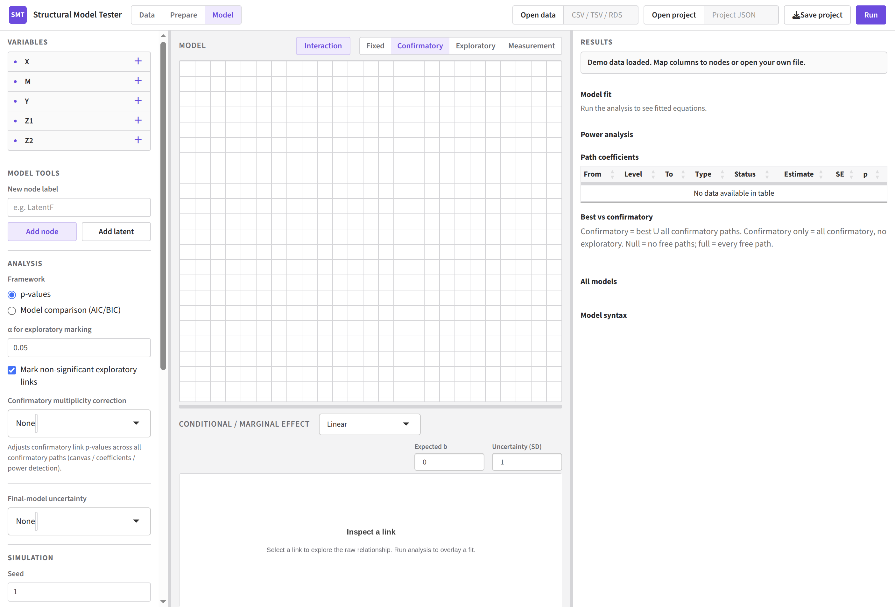
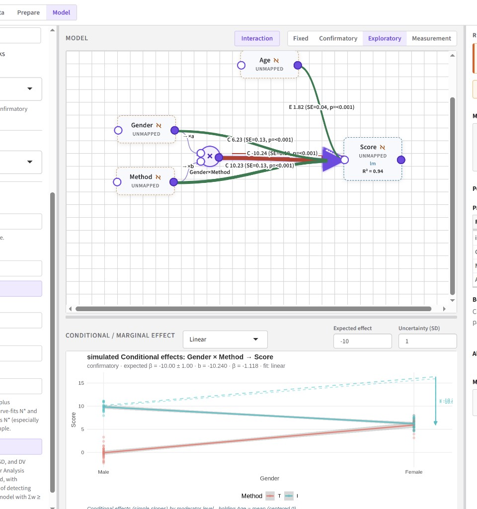
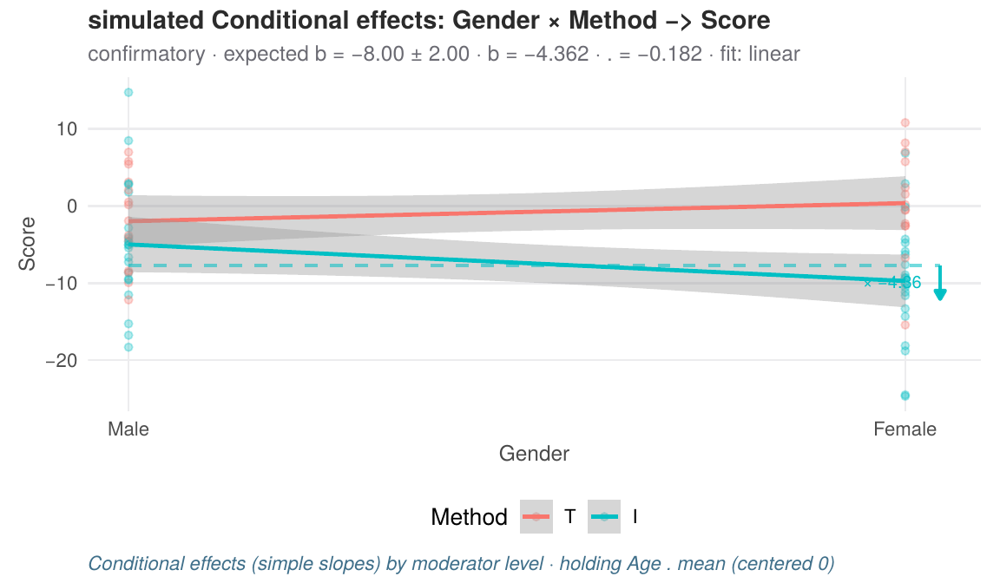
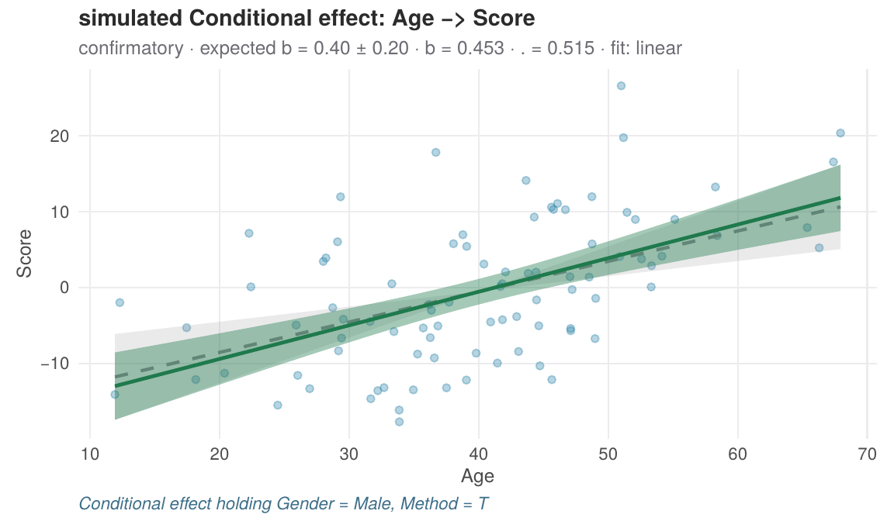
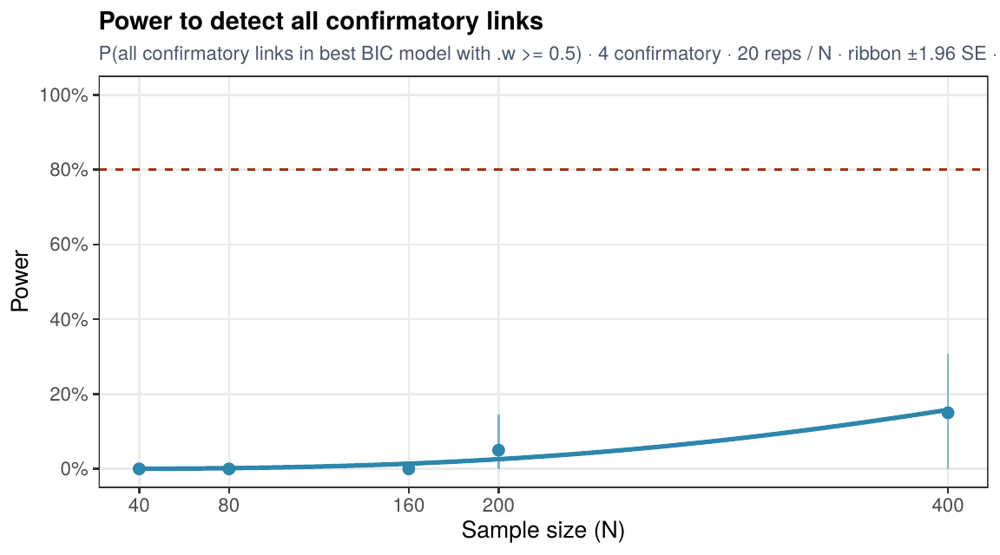
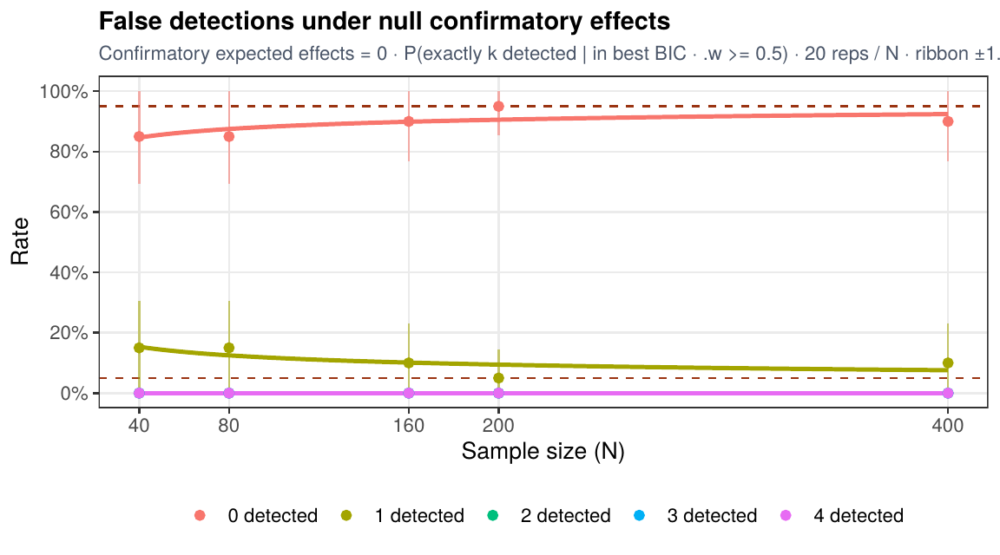

# Structural Model Tester

Visual path / SEM workbench for R: draw the model, set expected effects, simulate or fit real data, and plan sample size — in one Jamovi-inspired Shiny app.

<p align="center">
  
</p>

## What it does

- **Canvas model editor** — observed / latent / interaction (×) nodes; drag links that are *fixed*, *confirmatory*, *exploratory*, or *measurement*
- **Two inference frameworks** — classical **p-values** (optional exploratory marking + confirmatory multiplicity correction) or **AIC/BIC search** with optional full model averaging and **Σw** link rejection
- **Simulation from expected `b`** — unstandardized slopes on continuous predictors (mean-centered), treatment contrasts for factors, interactions coded like the fit
- **Conditional / marginal effect plots** — inspect a link with prior band, fit overlay, and interaction correction (ghost line + arrow)
- **Confirmatory power analysis** — Monte Carlo power and null false-detection curves, with a recommended **N\***

Works anywhere R runs (Linux, Windows, macOS) with a local browser.

## Screenshots

### Path diagram with interactions

<p align="center">
  
</p>

Build confirmatory mains and `Gender × Method` interactions on the canvas; dashed / solid styling reflects search or p-value decisions after **Run** or **Simulate**.

### Conditional effects

<p align="center">
  
</p>

Selecting a link opens the **Conditional / marginal effect** panel. Interaction plots show simple slopes by moderator level, a dashed *mains-only* ghost line, and a correction arrow in the active group’s colour.

<p align="center">
  
</p>

Continuous links use **Expected `b`** (raw slope), not standardized β — so simulation matches the units you type.

### Power and false detections

<p align="center">
  
</p>

<p align="center">
  
</p>

**Run Power Analysis** estimates detection power under your expected effects and, with confirmatory effects set to 0, the rate of detecting *k* spurious links. Search mode can require Σw ≥ a threshold (default 0.95) so N\* targets both power and low false retention.

## Install

```r
install.packages(c("devtools", "shiny", "ggplot2", "lavaan", "readr", "jsonlite", "DT", "lme4", "lmerTest"))
# from GitHub:
devtools::install_github("BapJacquet/StructuralModelTester")

# or from a local clone:
# remotes::install_local(".", force = TRUE)
```

**Requirements:** R ≥ 4.1 and a modern browser.

## Run

```r
library(StructuralModelTester)
run_app()
```

During development from the source tree:

```r
devtools::load_all()
run_app()
```

## Quick start

1. Demo columns (`X`, `M`, `Y`, `Z1`, `Z2`) load automatically — or **Open data** (CSV / TSV / RDS).
2. In **Variables**, click **＋** to place observed nodes (or **Add node** / **Add latent** / **Interaction**).
3. On **Model**, drag between ports. Choose link role: Fixed / Confirmatory / Exploratory / Measurement.
4. Set **Expected `b`** (and uncertainty) on selected structural links for simulation & power.
5. **Run** on loaded data, or **Simulate** from the generative settings, then inspect the canvas, equations, and link plots.
6. Optionally **Run Power Analysis** for confirmatory N\*.

**Save project** / **Open project** stores the graph (nodes, links, priors, sim knobs) as JSON. Data files are opened separately.

A ready-made interaction demo graph is in [`inst/sample_data/readme-demo-model.json`](inst/sample_data/readme-demo-model.json).

## Analysis modes (short)

| Mode | What “detection” means | Typical extras |
|------|------------------------|----------------|
| **p-values** | Confirmatory links with *p* below α (optional Bonferroni / Holm / BH) | Mark non-significant exploratory links |
| **AIC/BIC search** | Link in the best IC model; optional **Σw** floor to keep | Full model averaging; null vs confirmatory tables |

Final-model **bootstrap** or **plausible values** can be requested after the model is chosen (uncertainty conditional on that selection).

## License

MIT
